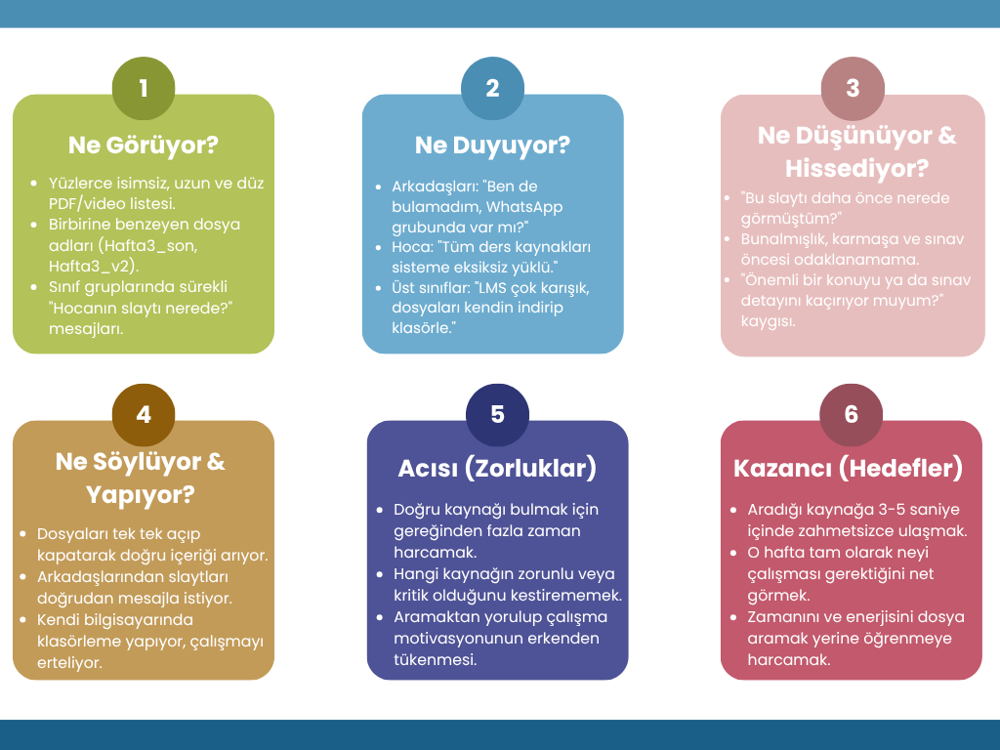
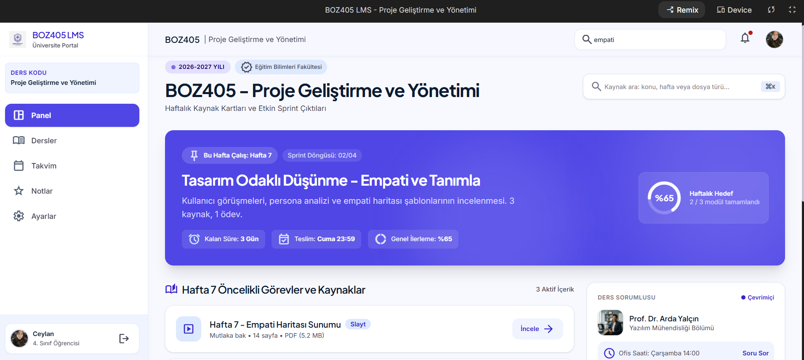
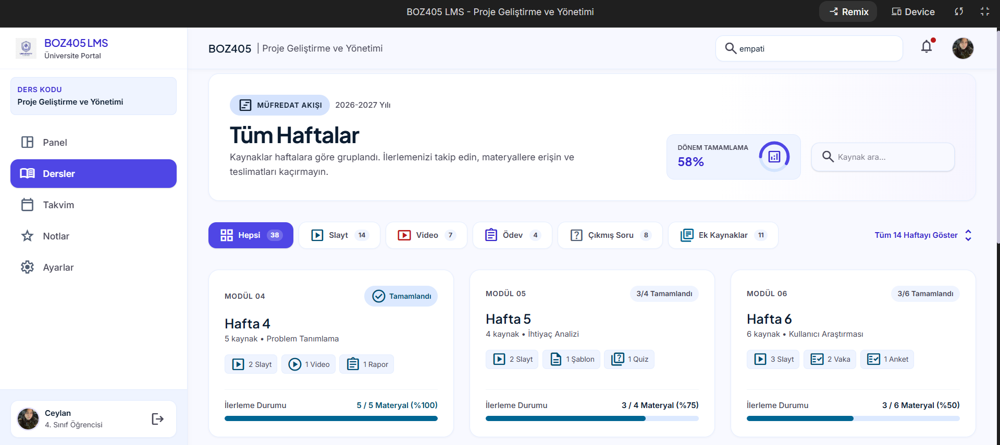
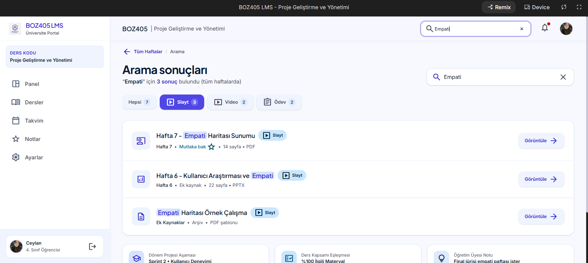

# BOZ405 Proje Geliştirme ve Yönetimi
## LMS Kaynak Yönetimi için Hızlı Tasarım Sprinti

- **Ad Soyad:** CEYLAN ULUSOY
- **Öğrenci No:** 23040192
- **Tarih:** 20 Ekim 2026
- **Süreç:** Mühendislik Tasarım Süreci'nin 5 aşaması (Empati → Tanımla → Fikir Üret → Prototiple → Test Et) 120 dakikalık bir sprintte uygulanmıştır.
- **Senaryo:** Üniversitenin LMS'indeki (Moodle, Canvas vb.) "Kaynaklar/Dosyalar" bölümü çok uzundur. PDF, video ve linkler kronolojik veya alfabetik tek bir listede sıralanır; öğrenciler kaynak bulmakta zorlanır, motivasyonları düşer ve zaman kaybederler.

---

### 1. Empati Haritası (Persona: Üniversite öğrencisi)

---

### 2. Problem Cümlesi ve HMW Sorusu

* **Problem Cümlesi:** Üniversite öğrencisi, ders kaynaklarına hızlıca ulaşmaya ihtiyaç duyuyor; çünkü kaynaklar kronolojik veya alfabetik uzun listelerde sıralandığı için aradığını bulmakla geçen zaman, asıl çalışma zamanını ve motivasyonunu tüketiyor.
* **HMW (Nasıl Yapabiliriz?):** Öğrencilerin, ihtiyaç duydukları ders kaynağına birkaç saniye içinde ulaşıp o hafta neyi çalışmaları gerektiğini net görmelerini nasıl sağlayabiliriz?

---

### 3. Beyin Fırtınası ve Seçim

| # | Fikir | # | Fikir |
| :-: | :--- | :-: | :--- |
| **1** | Haftalık görünüm (kaynaklar hafta kartlarında) | **6** | Önem sırası rozeti (Mutlaka bak / Ek kaynak) |
| **2** | Akıllı arama çubuğu (konu, hafta, tür filtresi) | **7** | Sohbet botu ile kaynak yönlendirme |
| **3** | "Bu hafta çalış" paneli | **8** | Oyunlaştırma (ilerleme çubuğu, rozet) |
| **4** | Renkli etiket sistemi (Slayt, video, ödev) | **9** | Konu zihin haritası görünümü |
| **5** | Öğrenci favorileri / yıldız | **10** | Haftalık özet e-postası |

* **Seçilen Çözüm:** **Haftalık Kaynak Kartları (Fikir 1 + 2 + 3 + 4)**  
  Kaynaklar haftalara bölünür, ana sayfada "Bu hafta çalış" paneli yer alır, her dosya renkli bir tür etiketi taşır ve arama/filtre bileşenleriyle taranabilir.
* **Seçim Gerekçesi:** Seçim ölçütlerim problemin kök nedenini ne kadar çözdüğü ve 120 dakikalık sprintte prototiplenebilirliğiydi. Empati haritasındaki en büyük acı "uzun düz liste" olduğu için bu çözüm doğrudan hiyerarşik yapı kurarak onu hedefliyor. Sohbet botu ve e-posta gibi fikirler 120 dakikada prototiplenip test edilemeyecek kadar karmaşıktı.

---

### 4. Prototip Ekran Görüntüleri

#### Ekran 1: Ana sayfa ("Bu hafta çalış" paneli)

#### Ekran 2: Tüm Haftalar ve Filtreler

#### Ekran 3: Arama sonuçları

---

### 5. Test Sonuçları

- **Test Eden Kişi:** Yaren (4. Sınıf Öğrencisi)
- **Görev:** *"Bu haftanın empati haritası sunumunu bul."*
- **En Önemli 2 Geri Bildirim:**
  1. Ana sayfadaki "Bu Hafta Çalış" paneli sayesinde arama çubuğunu kullanmaya bile gerek kalmadan ilgili haftanın slaytına 3 saniye içinde ulaştı; renkli tür etiketlerinin (Slayt, Video, Ödev) dosya formatını ayırt etmeyi çok hızlandırdığını belirtti.
  2. "Tüm Haftalar" ekranında gezinirken, mezuniyet ve yoğun dönem temposunda hangi kaynakları tamamlayıp hangilerini henüz açmadığını görebilmek için hafta kartları üzerinde küçük bir tamamlanma/okundu göstergesi aradığını ifade etti.
- **Yaptığım İterasyon:** 
  Geri bildirim doğrultusunda hafta kartlarının alt kısımlarına ince bir yeşil "tamamlanma/ilerleme çizgisi" (progress bar) eklendi; ayrıca arama sonuçları ekranında aranan kelimenin ait olduğu hafta bilgisi daha belirgin rozetlerle vurgulandı.

---

### 6. Bireysel Öğrenim Yansıması

- **En Önemli Öğrenimim:**
  Test aşamasından çıkardığım en şaşırtıcı içgörü; öğrencilerin yaşadığı asıl problemin sisteme dosya yüklenmemesi değil, **bilişsel karmaşa** ve **zaman baskısı** altında neye öncelik vereceğini bilememesi olduğuydu. Kullanıcılar pasif ve uzun bir dosya yığınından ziyade kendilerine yol gösteren sadeleştirilmiş bir çalışma rehberine ihtiyaç duyuyor.
- **Sürece Dair Yansıma:**
  Mühendislik Tasarım Süreci'nin 5 aşamasını 120 dakikalık hızlı bir sprintte uygularken; doğrudan arayüz çizmeye girişmek yerine empati ve tanımlama aşamalarında kök probleme inmenin sonraki kararları ne kadar netleştirdiğini fark ettim. Süre kısıtlı olduğunda fikirleri elerken uygulanabilirlik kriterinin kritik olduğunu, prototip üzerinden kullanıcı geri bildirimi almanın ise kişisel varsayımlardan çok daha doğru yön verdiğini deneyimledim.
